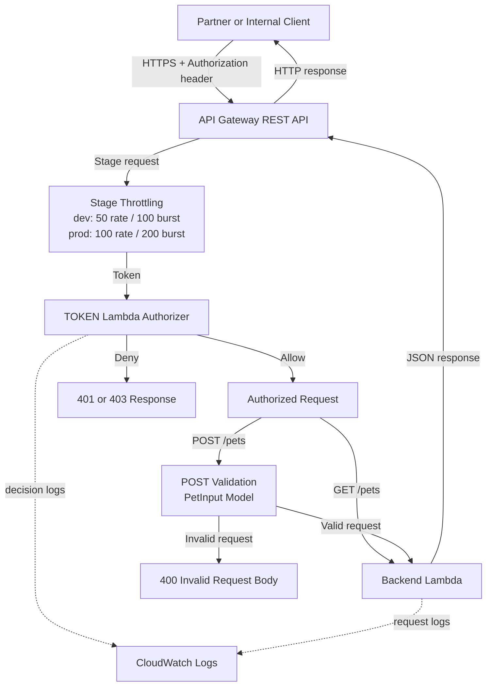
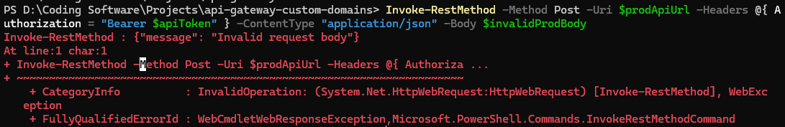
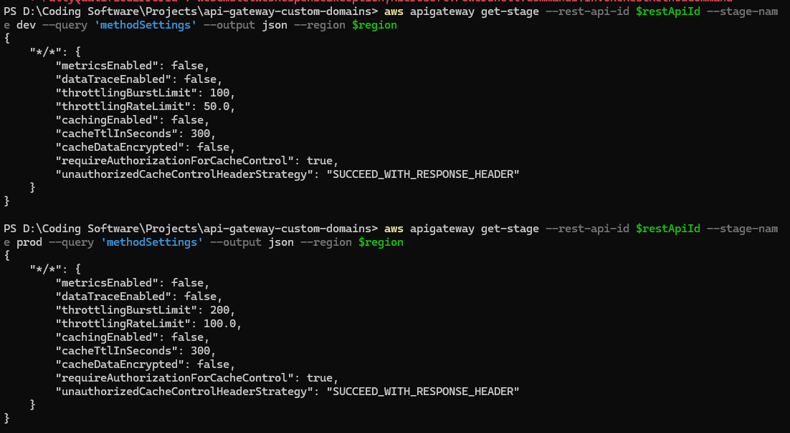

# Serverless Rest API — API Gateway + Lambda Authorizer

AWS REST API prototype demonstrating authorization, validation, deployment stages, throttling, and Lambda proxy integration in `us-east-1`.

## Problem

Partner systems and internal dashboards often need a controlled way to read shared records and submit data without exposing backend compute directly. In a hypothetical shelter network, approved applications might retrieve available pets and submit intake details. The API boundary must reject unauthenticated callers, stop malformed requests before they consume backend capacity, and separate development traffic from production traffic. This pet-intake prototype demonstrates those transferable controls without claiming a real organizational deployment.

## Solution

Amazon API Gateway exposes protected `GET /pets` and `POST /pets` methods through `dev` and `prod` stages. A TOKEN Lambda authorizer evaluates the `Authorization` header and returns an IAM-style Allow or Deny policy. API Gateway validates POST bodies against a `PetInput` model before Lambda proxy integration invokes the backend. CloudWatch Logs receives operational logs, while stage throttling limits request rates and bursts.

## Requirements

- AWS access to API Gateway, Lambda, IAM, and CloudWatch Logs in `us-east-1`.
- AWS Console or AWS CLI access to configure, deploy, and test resources.
- Backend Lambda `api-backend-cody01` and TOKEN authorizer Lambda `api-authorizer-cody01`.
- Lambda execution roles with required runtime and CloudWatch logging permissions.
- An `API_TOKEN` environment variable containing a non-production lab token.
- API Gateway REST API `api-service-cody01` and an HTTP client that sends JSON and an `Authorization` header.

## Architecture

## Build guide and verified results

1. **Implement the backend contract.** The backend Lambda handles listing and intake operations with controlled JSON `400` and `404` responses. This keeps transport behavior predictable for clients. Direct invocation with a valid POST produced an inner HTTP response of `201`.

2. **Add token authorization.** The authorizer reads the expected lab token from `API_TOKEN` and generates an IAM-style Allow or Deny policy. Attaching `CUSTOM` authorization to both methods blocks unauthenticated API invocation. In `prod`, a GET without a token returned `401`; the authorized request returned `200`.

3. **Configure routes and deployments.** `GET /pets` and `POST /pets` use `AWS_PROXY` integration, preserving the backend status code, headers, and JSON body. Separate `dev` and `prod` stages support safer promotion and independent operational settings.

4. **Validate intake data at the gateway.** The `PetInput` model and request validator require `name` and `type` before POST reaches Lambda. This saves backend work and gives clients a consistent failure mode. Invalid POST requests returned `400 Invalid request body` in both `dev` and `prod`.

5. **Apply traffic controls.** Throttling was set on `*/*`: `dev` uses a rate of 50 with a burst of 100, while `prod` uses a rate of 100 with a burst of 200. These limits demonstrate environment-specific reliability and cost protection.

## Limits and next steps

Pet records live only in Lambda memory and are not durable across execution environments. The static token is lab-only; production authentication needs managed identities, rotation, and stronger authorization policies. A custom domain, ACM certificate, Route 53 records, and DNS configuration were intentionally deferred and are not completed. Next steps include persistent storage, automated infrastructure deployment, integration tests, monitoring alarms, and production-grade identity controls.

**Redaction note:** Published documentation and screenshots must omit credentials, token values, account IDs, ARNs, credential files, and API invoke URLs.
